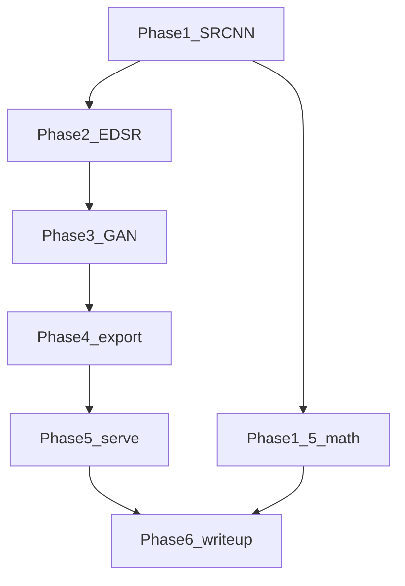

# Phase roadmap

Finish the ×4 super-resolution roadmap in CLAUDE.md in order: complete the SRCNN baseline on the existing eval contract, then run the math track and EDSR-lite in parallel, then real-world GAN training, export, tiled serving, and the write-up.

Work stays on feature branches off `main` (currently checked out: `phase1`). Every method is registered in [`eval.py`](eval.py) and scored by the existing contract: ×4, LR only from [`data/degrade.py`](data/degrade.py) `make_lr_hr_pair`, clamp and round to uint8, PSNR/SSIM on Y with a 4 px crop. LPIPS and `ms_per_image` stay blank until Phases 3 and 4. Datasets and checkpoints stay out of git.



## Already done on `phase1`

- Shared bicubic downscale and modcrop in [`data/degrade.py`](data/degrade.py).
- Contract metrics in [`metrics.py`](metrics.py), with a scikit-image SSIM cross-check.
- [`eval.py`](eval.py) plus bicubic rows in [`results/results.csv`](results/results.csv) (Set5 28.43 dB, in line with published ×4 bicubic).

## Phase 1 — SRCNN baseline — done

- [`data/dataset.py`](data/dataset.py): DIV2K train patches. Modcrop, random crop, LR via `bicubic_downscale` (never a second resizer), flips and 90° rotations. The paper's 33 px patch is the center of a slightly larger crop, because 33 is not divisible by 4. DIV2K valid is the training-time check; Set5/14, BSD100, Urban100 are eval-only.
- [`models/srcnn.py`](models/srcnn.py): bicubic-upsample, then three convs (9×9 → 64, 5×5 → 32, 5×5 → 1) with ReLU on the first two. Train and run on the Y channel; Cb and Cr come from the bicubic upsample. Kernels are valid, with a reflect pad so the output stays the same size as HR.
- [`configs/srcnn.yaml`](configs/srcnn.yaml): MSE, SGD, 1e-4 on the last layer and 1e-5 on the earlier ones. Seed logged.
- [`train.py`](train.py): config-driven loop, `model.train()` / `model.eval()`, `torch.no_grad()` for val, checkpoints under `outputs/` (gitignored), runs to the shared W&B project.
- `srcnn` is registered in [`eval.py`](eval.py). A DIV2K-trained 9-5-5 net should land above the bicubic 28.4 dB on Set5; the TPAMI 2016 figure is about 30.5 dB, and a different training set will not match that exactly. The results row is written by the eval command below once DIV2K and the test sets are on disk (they stay out of git).

```bash
python train.py --config configs/srcnn.yaml
python eval.py --method srcnn --checkpoint outputs/srcnn/best.pt
```

## Phase 1.5 — pure math (parallel with Phase 2)

Own implementations under `classical/`, each a `Method` with `params=0` and `train_data=none`:

- Bicubic and Lanczos kernels written out, so the result can be compared to Pillow rather than wrapped.
- Iterative back-projection: upsample, blur, subtract the residual, repeat.
- TV-regularized reconstruction: data term plus total variation, solved by a small iterative method (Chambolle or a primal-dual step). Explain the energy before the solver.
- Wrong-blur experiment: build the LR with one Gaussian, reconstruct assuming another, and record the PSNR drop in `results/`. This is a separate row, not a change to `make_lr_hr_pair`.

## Phase 2 — EDSR-lite (parallel with 1.5)

- `models/edsr_lite.py`: residual blocks (conv, ReLU, conv, plus a scaled skip) and a pixel-shuffle head. Pixel shuffle is why it is cheaper than SRCNN: it learns the ×4 upsample in channels and rearranges them into space, instead of running convs on an already-upsampled image.
- Loss is L1. `configs/` holds the ablations (depth, width, L1 vs L2), one YAML each, same `train.py`.
- A small EDSR will not match the full EDSR Set5 number (~32.5 dB). Expect it a step above SRCNN; say so in the table notes.

## Phase 3 — real-world degradation and GAN

- Second-order degradation for **training only** (blur, downsample, noise, JPEG, applied twice). Test LR for the official table still comes from `make_lr_hr_pair`. Scoring those models on a different test resize would change the contract and needs both people to agree first.
- `models/discriminator.py`, perceptual (VGG) plus adversarial loss, weights in YAML.
- LPIPS on RGB inside `score`, and fill the `lpips` column from here on. GAN outputs often lose a little PSNR and look sharper; report both.

## Phase 4 — export and speed

- `export/onnx_export.py`, then TensorRT FP16 and INT8 (`build_trt.py`, `calibrate.py`). INT8 needs a calibration set of real LR patches; say which set.
- `bench/`: warmup, `torch.cuda.synchronize()`, median of 100 runs, fixed 256×256 LR. That is the only source of `ms_per_image`.
- One speed-vs-quality table in `results/` covering PyTorch, ONNX, FP16, INT8.

## Phase 5 — tiled serving

- `serve/`: FastAPI, tile with overlap and blend (seams are the usual failure), dynamic batching, a metrics endpoint.
- `loadtest/locustfile.py` against that service. Latency here is service latency, not the bench number; keep them in separate columns.

## Phase 6 — dashboard and write-up

- Dashboard of live service metrics plus a before/after crop demo. Small crops go in `results/samples/` only.
- README a stranger can read in 30 seconds: what ×4 SR is, the one results table, how to run `eval.py`. Tick the phase checkboxes in [`CLAUDE.md`](CLAUDE.md) as each phase lands, and add commands there only once they actually run.

Working style from CLAUDE.md: explain a new idea (pixel shuffle, TV, INT8 calibration) before the code, keep modules small, and flag anything that would change how scores are computed.
